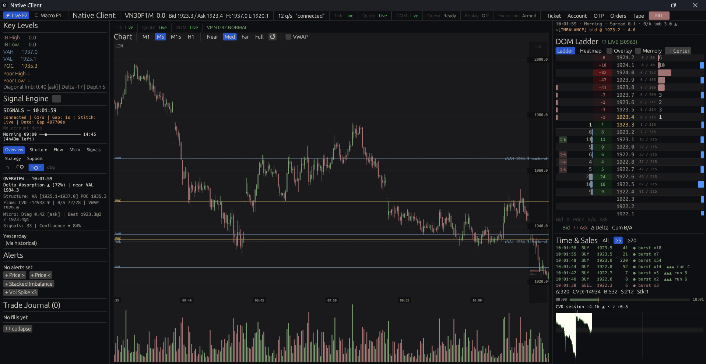
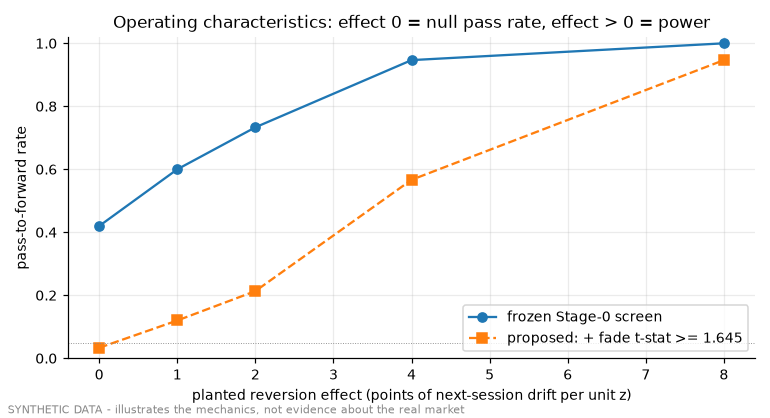
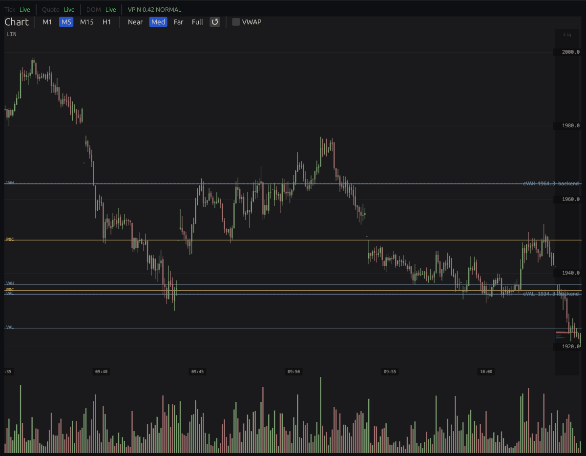
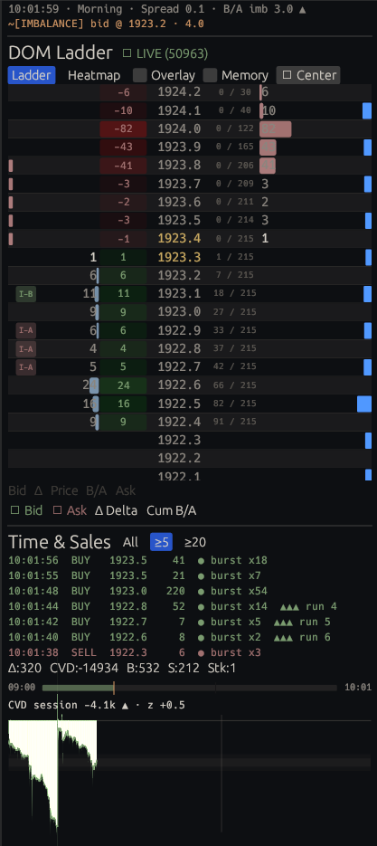
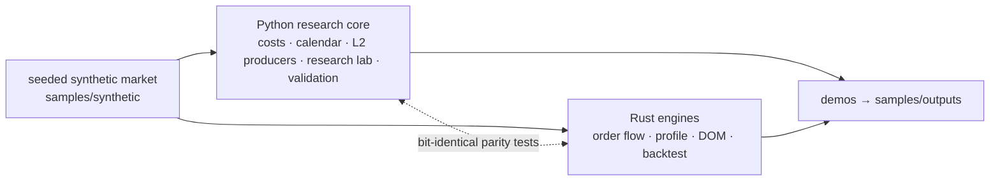

# VN30 order-flow platform

Research infrastructure and order-flow engines for **VN30 index futures (VN30F1M)**: a
regulation-accurate cost model, a basis screen against the cash index, order-flow and market-profile
features implemented twice (Python for research, Rust for the engines) and proven bit-identical, and
a validation protocol that pre-registers every test, locks a holdout in code, and records its own
failures.

> **Status:** personal project, paper/demo only — no live capital. Orders only ever went to the
> broker's paper-trading (demo) account; in the research record, "live" means real time on that
> account, and the protocol's real-money tier (Tier L) was never reached. Everything in this
> repository runs **offline on seeded synthetic data**: no broker, database or network is needed,
> and the only real market data are the terminal screenshots. Numbers quoted from the private
> research record are labelled as such. This is a snapshot of the working repository (373 commits,
> Nov 2025 → Sep 2026) with a fresh history — see [provenance](docs/provenance.md).



*The author's order-flow terminal (Rust, egui/wgpu) on the live VN30F1M feed with a paper account. The
GUI is not published; the engines and view models behind its panels are — see [Terminal](#terminal).*

**Evaluate it:** [5 minutes](#evaluate-in-5-minutes) · [terminal](#terminal) · [scope](#this-repository-and-the-full-system) ·
[knowledge map](docs/knowledge/00-index.md) · [architecture](docs/architecture.md) ·
[provenance](docs/provenance.md) · [Tóm tắt tiếng Việt](#tóm-tắt-tiếng-việt)

---

## Evaluate in 5 minutes

```bash
pip install -r requirements.txt                          # Python 3.13
python demos/run-all.py                                  # 7 demos, ~2 min once Rust is built
python -m pytest -q                                      # 698 Python tests
cd native_platform && cargo test --workspace --locked    # 494 Rust tests; Rust 1.94 is pinned
```

Rust is optional for a first look: without `cargo`, demo 02 runs only its Python half, and demos
06–07 and the Rust half of the parity tests are skipped, each with a message that says so. With it,
the first build takes a few minutes.
The outputs are committed (produced on Windows 11 with CPython 3.13.15), so you can also just read
them. On another platform demo 03's Monte-Carlo rates can move by about one percentage point
(floating-point results differ in the last bits between platforms, which flips a few marginal
synthetic markets; checked on Linux), and demo 07 measures the local machine.

| Demo | What it shows | Output |
|---|---|---|
| 01 cost model | the derivatives-tax correction, frozen cost bars, maker vs taker, break-even slippage as a curve | [report](samples/outputs/01-cost-model/report.md) |
| 02 order-flow parity | CVD / TPO computed by Python and Rust on the same tape — byte-identical | [report](samples/outputs/02-order-flow-parity/report.md) |
| 03 basis screen | the screen's verdicts, the holdout lock refusing reserved dates, and the screen's own error rates | [report](samples/outputs/03-basis-screen/report.md) |
| 04 same-second prints | why candle closes need `(timestamp, ingest_seq)` | [report](samples/outputs/04-same-second-prints/report.md) |
| 05 validation statistics | best-of-N looks significant and is not: PSR vs DSR, PBO, MinBTL | [report](samples/outputs/05-validation-statistics/report.md) |
| 06 Rust backtest | deterministic backtester and its fill-model ladder on a synthetic tick tape | [report](samples/outputs/06-rust-backtest-fill-models/report.md) |
| 07 loopback latency | a one-way latency probe, and why an older figure measured something else | [report](samples/outputs/07-loopback-latency/report.md) |



*Demo 03: how often the frozen basis screen passes synthetic markets with a known effect. With no
effect at all it still passes ~42 % of them on one year of daily data — which is why the screen only
nominates a pre-registered forward test and is never read as evidence of an edge.*

**Three ways in.** *5 minutes:* this page and the committed reports above. *30 minutes:* run the
demos, then read `historical/backtest_engine/costs.py` (the cost model),
`historical/research_lab/basis_screen.py` (a pre-registered screen) and
`historical/tests/test_l2_parity_cvd.py` (the parity contract). *Deep:* the
[knowledge map](docs/knowledge/00-index.md), then the [decision records](docs/decisions/README.md).

## Terminal

<p>
  
  
</p>

The terminal runs against the private gateway; the screenshots show it on the live feed. What its
panels compute comes from crates in this repository:

| Panel | Code in this repository |
|---|---|
| DOM ladder: sizes, per-level delta, imbalance markers (I-A / I-B) | `market-dom-engine`, `market-dom-viewmodel`, `orderflow-engine` (`imbalance`), `orderflow-viewmodel` |
| Session CVD and trade delta | `orderflow-engine` (`delta`, `cvd`), `orderflow-viewmodel` |
| VPIN regime in the chart header | `orderflow-engine` (`vpin`) |
| Value area, POC and composite levels on the chart | `market-profile-engine`, `market-profile-viewmodel`; profile queries in `gateway-service` |
| Frames between gateway and terminal | `client-proto` |
| Chart and ladder widgets, tape burst tags, signal panel, order and risk panels | the terminal itself (not published) |

## This repository and the full system

The full system runs tick and order-book data through features and signals to automated orders on
the paper account, with reconciliation. Only the parts that run without a broker, database or
network are published; the rest is described with references to the private code.

| Part of the system | In this repository | Where to look |
|---|---|---|
| Order-flow and microstructure features (CVD, OBI, OFI, VPIN, TPO/value area) from ticks and the 10-level book | code + tests | `native_platform/crates/orderflow-engine`, `market-profile-engine`; Python producers in `historical/l2/`; [knowledge 05](docs/knowledge/05-order-flow-features-and-parity.md), [06](docs/knowledge/06-market-profile.md) |
| Signal evaluation, strategies and a deterministic backtester with a fill-model ladder | code + tests | `native_platform/crates/signal-engine`, `strategy-core`, `backtest-engine`; demo 06 |
| Cost model, basis screen, validation statistics, research protocol | code + tests + demos | `historical/`; demos 01, 03, 05; [knowledge 02](docs/knowledge/02-transaction-cost-and-pit-tax.md), [04](docs/knowledge/04-basis-and-index-arbitrage.md), [07](docs/knowledge/07-research-integrity.md), [08](docs/knowledge/08-validation-evolution.md) |
| Wire protocol and view models of the trading terminal (DOM, order flow, market profile) | code + tests | `client-proto` and the `*-viewmodel` crates; [knowledge 10](docs/knowledge/10-rust-native-platform.md) |
| Auto-trade loop: orders, fill / cancel / reject tracking, position reconciliation, kill | described, not shipped | [knowledge 11](docs/knowledge/11-execution-safety.md), [architecture](docs/architecture.md) |
| Broker adapter, MQTT ingest, Redis hot state, ClickHouse store | described, not shipped (the L2 table DDL is included) | [knowledge 09](docs/knowledge/09-data-platform-and-provenance.md), ADR [0021](docs/decisions/0021-clickhouse-canonical-schema.md) / [0032](docs/decisions/0032-market-data-storage-standard.md), `data_provider/orderflow/sql/migrations/` |
| GPU desktop terminal (egui/wgpu) | not shipped; screenshots above, and its engines and view models are here | [Terminal](#terminal), [knowledge 10](docs/knowledge/10-rust-native-platform.md) |

## What this demonstrates

| # | Knowledge unit | Headline |
|---|---|---|
| 01 | [Contract, sessions, calendar](docs/knowledge/01-contract-sessions-calendar.md) | a holiday calendar derived from the tape; the session has two closes |
| 02 | [Cost and the PIT correction](docs/knowledge/02-transaction-cost-and-pit-tax.md) | tax base = notional × IM/2 — the tax term had been ~5.9× too high |
| 03 | [Execution realism](docs/knowledge/03-execution-realism-and-fill-models.md) | taker slippage measured on the recorded tape at 0.2 pt; maker economics estimated from recorded books |
| 04 | [Basis and index arbitrage](docs/knowledge/04-basis-and-index-arbitrage.md) | why cash–futures arbitrage is a prop-desk trade |
| 05 | [Order-flow features and parity](docs/knowledge/05-order-flow-features-and-parity.md) | one name, one formula, two stacks, zero tolerance |
| 06 | [Market profile](docs/knowledge/06-market-profile.md) | value-area tie rules pinned by a shared golden fixture |
| 07 | [Research integrity](docs/knowledge/07-research-integrity.md) | pre-registration, a holdout lock enforced in code, a ledger of trials — and of breaches |
| 08 | [Validation, three generations](docs/knowledge/08-validation-evolution.md) | a gate retired because measurement showed nothing could pass it |
| 09 | [Data platform and provenance](docs/knowledge/09-data-platform-and-provenance.md) | second-resolution stamps need an ingest sequence |
| 10 | [Rust native platform](docs/knowledge/10-rust-native-platform.md) | deterministic engines, bounded backpressure, a latency number re-measured |
| 11 | [Execution safety](docs/knowledge/11-execution-safety.md) | one writer, netted exposure, kill first |
| 12 | [Engineering method](docs/knowledge/12-engineering-method.md) | AI-assisted, specification-first, gated by evidence |

## Architecture



Two stacks that never link against each other (ADR 0005), meeting only through data and parity
tests. The private deployment adds a broker feed, ClickHouse, Redis, a gateway and a GPU client;
the full picture is in [docs/architecture.md](docs/architecture.md).

## Design decisions

| Decision | Reason |
|---|---|
| Rust owns realised P&L; Python mirrors the cost model and never declares its own constants | three disagreeing fee constants and a 5×-wrong tick once lived in strategy files |
| Critical formulas implemented twice and compared bit for bit | a control that does not depend on trusting either implementation, human- or AI-written |
| Cost bars are frozen; changing one needs a new pre-registration | quoting a looser bar after seeing a result is goalpost-moving |
| A holdout range is locked in code and spent once | two unguarded reads were found and recorded; guards now fail closed |
| Synthetic, seeded data in this repository | exchange data is not redistributable; demos must run anywhere |

## Evidence behind the headline numbers

| Claim | Reproducible here? | Where to check |
|---|---|---|
| Round-trip fee 0.31–0.43 pt at prices 1,250–1,915 (`0.0995 + 0.00017 × price`); the tax term was ~5.9× overstated before the fix | yes | demo 01 (sweeps 900–1,900); `historical/backtest_engine/costs.py`; ADR 0020 |
| Python and Rust agree bit for bit on CVD and TPO | yes | demo 02; `historical/tests/test_l2_parity_cvd.py`, `test_l2_parity_tpo.py` |
| The basis screen passes ~42 % of pure-noise markets at one year of daily data | yes | demo 03 §4 |
| One-way loopback latency p99 ≈ 0.2 ms (paced, blocking reader) | yes, machine-dependent | demo 07; [knowledge 10](docs/knowledge/10-rust-native-platform.md) |
| Taker slippage 0.2007 pt per fill, measured on 5.77 M market prints of the recorded tape | no — private data | quoted in `historical/research_lab/PRE_REGISTRATION.md` (A18); [knowledge 03](docs/knowledge/03-execution-realism-and-fill-models.md) |
| Maker economics: fill probability ≥ 0.90, adverse selection 0.045 pt — a queue walk over recorded books (the live resting-limit probe has not been run) | no — private data; the formula is here | [knowledge 03](docs/knowledge/03-execution-realism-and-fill-models.md); `CostScenario.PASSIVE_QUEUE_E1` in `costs.py` |
| Intraday basis half-life ~10 min; futures lead the cash index | no — private data | [knowledge 04](docs/knowledge/04-basis-and-index-arbitrage.md) |
| 43 cards, ~300 trials, zero promotions | no — private record, quoted | `historical/research_lab/PRE_REGISTRATION.md` (A18); `trials.jsonl` |
| Full Rust workspace: 17 libraries + 2 applications, ~107k lines, 1,366 tests (this edition: 15 crates, 494 tests) | no — private | [provenance](docs/provenance.md) |

## Engineering method

Built by the author with an AI coding agent under a specification-first workflow: risk-classified
intake, decision records, a test matrix, generated status pages and parity tests. In the working
history 275 of 373 commits were written by the agent; the author set direction, made the recorded
research decisions and owns the gates. Details: [docs/knowledge/12-engineering-method.md](docs/knowledge/12-engineering-method.md).

## Repository map

```
historical/          Python research core: costs, research lab, L2 producers, validation statistics, tests
shared/              shared quant primitives (value area, forecast contract)
data_provider/       session phases, market calendar, data-quality checks, L2 table DDL (ingest services not included)
specs/features/      the L2 feature registry: one YAML contract per feature
native_platform/     Rust workspace (15 crates): engines, backtester, transport — see its README
samples/             synthetic market generator, fixtures generator, committed demo outputs
demos/               numbered, offline demos + run-all.py
docs/                knowledge map, architecture, decision records, provenance, L2 feature status
.github/workflows/   CI: Rust fmt/clippy/tests, Python tests with Rust parity, demos, full-history secret scan
```

Test status at the time of distillation: **698 Python tests pass** (4 skip: they need real data files
that are not redistributed) including the Rust half of the parity tests; **494 Rust tests pass**;
`cargo fmt --check` and `cargo clippy -D warnings` are clean; all 7 demos run in about 2 minutes once
the Rust workspace is built. The CI workflow runs the same checks on Linux for every push.

## Provenance and scope

Distilled from the author's working repository (Nov 2025 → Sep 2026) into a fresh history: the
working history holds material that must not be published (account identifiers, infrastructure
addresses, secrets in early commits, raw market data). Excluded: broker and database adapters, the
gateway and desktop applications, real market data, credentials and operational tooling. Kept code
is original — its comments and docstrings were condensed for this edition — and every kind of edit
made while distilling is listed in [docs/provenance.md](docs/provenance.md).

## Tóm tắt tiếng Việt

Nền tảng nghiên cứu và giao dịch tự động hợp đồng tương lai chỉ số VN30 (VN30F1M), dự án cá nhân.
Hệ thống đầy đủ đi từ dữ liệu tick và sổ lệnh 10 mức → đặc trưng order flow → tín hiệu → đặt lệnh tự
động trên tài khoản paper → đối soát vị thế. Repo này công bố phần lõi chạy offline:
- Mô hình chi phí đúng Thông tư 87/2026/TT-BTC: thuế TNCN phái sinh tính trên ½ ký quỹ ban đầu.
- Đặc trưng order flow và market profile (CVD, OBI, OFI, VPIN, TPO/value area) viết ở cả Python lẫn
  Rust; CVD và TPO được test trùng khớp từng bit giữa hai bản.
- Màn hình basis VN30F1M–VN30, kèm khoá holdout bằng code và tỷ lệ báo động giả của chính màn hình.
- Khung kiểm định 3 thế hệ: đăng ký trước, sổ ghi mọi phép thử, bãi bỏ cổng khi đo được không thể vượt.
- Backtester Rust tất định với thang mô hình khớp lệnh.

Terminal order flow viết bằng Rust (egui/wgpu) chạy riêng tư; ảnh chụp ở mục [Terminal](#terminal), còn
engine và view-model của nó nằm trong `native_platform/`.

Trạng thái: chỉ chạy paper/demo, chưa dùng vốn thật. Dữ liệu trong repo là dữ liệu tổng hợp có seed,
trừ ảnh chụp terminal. Chạy thử: `python demos/run-all.py`. Phần không công bố (adapter broker, ingest, Redis,
ClickHouse, vòng auto-trade, terminal) được mô tả trong `docs/`.

## License

Evaluation license — you may clone, build, run and modify locally to evaluate the author's work;
see [LICENSE](LICENSE).
