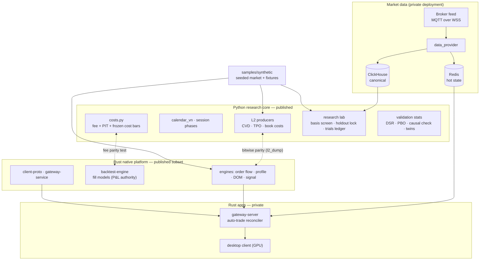

# Architecture

Two stacks that never link against each other (ADR 0005): a **Python research core** optimised for
iteration and statistics, and a **Rust native platform** optimised for deterministic engines and
low-latency transport. They meet only through stores and through **parity tests** that run both
implementations on the same frozen input.

## Boundaries that matter

| Boundary | Rule | Enforced by |
|---|---|---|
| Python ↔ Rust | no FFI; a formula that exists in both must match bit for bit | `historical/tests/test_l2_parity_*.py`, `test_fee_parity.py` |
| Cost | the Rust fill simulator owns realised P&L; Python mirrors and never declares its own constants | ADR 0008 / 0023, `costs.py` header |
| Data time | research reads only DEV-range sessions; reserved sessions are spent once, at a final verdict | `holdout_lock.json` + guards |
| Features | a feature name is a contract (versioned, unit-suffixed, parity-proven) | ADR 0037, feature registry |
| Execution | the auto-trade loop is a single writer; operator kill commands pre-empt queued decisions | private gateway (described in `knowledge/11`) |

## What runs offline in this repository

Everything under `historical/`, `shared/`, `native_platform/`, `samples/` and `demos/` runs on a
laptop with Python 3.13 and Rust 1.94: no broker, ClickHouse, Redis or network access, on seeded
synthetic data. The ingest services and the applications are described, not shipped
(`docs/provenance.md`).
