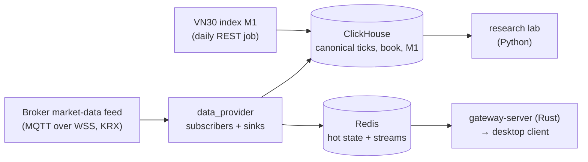

# 09 · Data platform, provenance and the contract roll

> **Desk relevance.** Every price a desk trades on passes through an ingest path. This unit shows
> the path as built, the provenance columns that make a candle reproducible, and two incidents
> where the data was wrong in ways a backtest would never notice.

## Path as built

- ClickHouse is the canonical store. An earlier SQL Server sink was **retired** by ADR 0021; the
  historical migration path (SQL → ClickHouse, CSV → ClickHouse) is kept as tooling.
- The cash index arrives once a day, so the basis series (`F1M.close − VN30.close`, joined on the
  minute) is a research series, not a live one.

## Provenance: why every row carries `ingest_seq`

Exchange timestamps have **second** resolution, but the book updates about 28 times a second
(420,987 book rows on 14,954 distinct stamps in one session). Two consequences:

1. Rows carry `recv_time`, `feed_id` and a process-wide monotonic `ingest_seq`, so the arrival order
   inside a second is recoverable.
2. **The candle-close incident.** Minute bars were built with "the price at the latest timestamp"
   (`argMax(price, event_timestamp)`). With several prints in the final second and storage merges
   reordering rows, that picks an arbitrary one: an audit found the wrong close on **56 %** of M1
   bars, and still **46 %** on a day with a perfect feed — so the defect was the key, not the
   feed. The fix is the deterministic key `(event_timestamp, ingest_seq)`.
   `demos/04-same-second-prints.py` reproduces the mechanism on the synthetic tape.

## Data quality gates

| Check | What it enforces |
|---|---|
| CSV validator | schema, duplicates, ordering, OHLC consistency, session bounds, coverage, jumps; GO / NO-GO |
| Bar-count and minute-gap functions | missing minutes per session, anomaly flags |
| Coverage | MISSING / PARTIAL session definitions over 9 canonical 30-minute periods |
| Reconcile | CSV vs store, filtering out look-alike symbols (VN100 futures, second-month contract) |
| Deploy preflight | interface/import/version checks, added after a partial-deploy incident |

## Contract roll

- Front month rolls **after** the expiry session (third Thursday, holiday-shifted).
- KRX symbol codes: `41` + product (`I1` = VN30) + year letter (F = 2025, G = 2026, H = 2027; unknown
  years raise instead of extrapolating) + month code (`1`–`9`, then `A`/`B`/`C`) + `000`.
- The roll guard separates **detect** from **commit**: it commits only after the new subscriber
  exists, fails loud when the venue says the contract is not listed, and re-checks every 60 s.
- There is no back-adjusted continuous series. Research handles the roll by **excluding**
  roll-boundary pairs (`04-basis-and-index-arbitrage.md`).

## Code, demo

| What | Where |
|---|---|
| Data-quality functions, stream writer/reader | `data_provider/` (distilled subset; see `docs/provenance.md`) |
| Demo | `python demos/04-same-second-prints.py` |

## Limits

The ingest services themselves need a broker feed, ClickHouse and Redis; they are described here,
not runnable offline. The Rust roll logic has no holiday calendar — the Python calendar
(`01-contract-sessions-calendar.md`) is the one that knows Tet.
