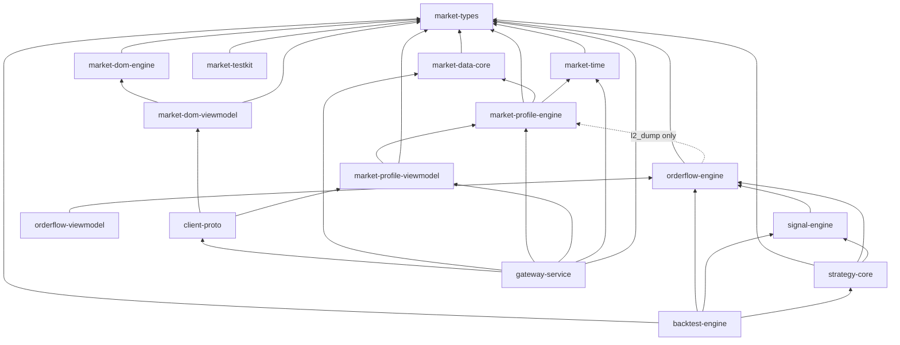

# native_platform: Rust engines for VN30F1M

A 15-crate Rust workspace taken from a private VN30F1M (VN30 index futures) trading platform. It
holds the parts that build and test without any broker, database, network service or GPU: domain
types, the session calendar, order-flow, market-profile and DOM engines, a signal engine, strategies,
a deterministic backtester and the client wire protocol. The unpublished parts, and why, are listed in
[What is not here](#what-is-not-here).

- 76 `.rs` files, 26,650 lines (24,444 non-blank), **494 tests**, all offline.
- No `unsafe` anywhere: `unsafe_code = "forbid"` and `unused_must_use = "deny"` apply to every crate.
- `Cargo.lock` is committed. `rust-toolchain.toml` pins Rust **1.94.0** (with rustfmt and clippy).

## Build and test

Run cargo from this directory, so that `rust-toolchain.toml` selects 1.94.0.

```sh
cargo fmt --all --check
cargo clippy --workspace --all-targets --locked -- -D warnings
cargo test --workspace --locked
```

After one online `cargo fetch --locked`, every command also works with `--offline`.

## Crate map

Line counts are non-blank lines, tests included. Test counts are `#[test]` and `#[tokio::test]`
functions (proptest cases included); together they equal the 494 that `cargo test` runs.

| Crate | Layer | Purpose | Lines | Tests |
|---|---|---|---:|---:|
| `market-types` | domain | Parse-don't-validate newtypes: fixed-point `Price`, non-negative `Volume`, `Tick`, `BookSnapshot` | 631 | 10 |
| `market-time` | domain | ICT (UTC+7) sessions 09:00–11:30 and 13:00–14:45, session keys, initial-balance window, tick-time checks | 177 | 3 |
| `market-data-core` | data contracts | Provider and executor traits; `close_position` flattens using the server-side net position | 503 | 7 |
| `market-dom-engine` | engine | Top-N order-book snapshot normaliser, malformed-book flag, as-of trade/quote join | 1,494 | 58 |
| `market-profile-engine` | engine | TPO and volume profiles, POC and value area with written tie rules, IB references, 80% Rule | 3,167 | 70 |
| `orderflow-engine` | engine | Delta, CVD and exhaustion divergence, VPIN, OBI, multi-level OFI, imbalance stacks, VWAP, ATR, RSI, ADX; `l2_dump` parity binary | 4,905 | 159 |
| `signal-engine` | engine | SIG-001 three-tier evaluator (VPIN veto, 80% Rule bias, CVD divergence) and ATR trailing stop | 1,469 | 26 |
| `strategy-core` | engine | `Strategy` trait shared by backtest and live, 12 strategies, fail-closed TOML registry | 4,382 | 60 |
| `backtest-engine` | engine + CLI | Deterministic tick-lane backtester, VN30F1M fee and PIT-tax model, fill-model ladder; `backtest` CLI | 2,104 | 30 |
| `market-dom-viewmodel` | view model | DOM views for the wire and the UI | 282 | 8 |
| `market-profile-viewmodel` | view model | Profile views, TPO letter encoding | 604 | 5 |
| `orderflow-viewmodel` | view model | CVD and imbalance views | 101 | 3 |
| `client-proto` | transport | 20-byte big-endian frame header, 71 message kinds, JSON payload types; `loopback_latency` example | 1,785 | 20 |
| `gateway-service` | transport | Request handlers over the provider traits; circuit breaker and cache for profile queries | 2,747 | 32 |
| `market-testkit` | test support | JSON tick-fixture loader | 93 | 3 |

External runtime dependencies: `serde`, `serde_json`, `chrono`, `thiserror`, `toml`, `async-trait`,
`log`. Test and example only: `proptest`, `tokio`, `hdrhistogram`.

## Dependency graph

Edges are normal (non-dev) dependencies between workspace crates.



## Binaries and examples

### `l2_dump`: cross-stack parity dumps

`l2_dump` runs the engine code on a tape and prints integer outputs, so that the Python producers in
`historical/l2/` can be compared with it exactly (`historical/tests/test_l2_parity_*.py`). On the
synthetic fixtures:

```sh
cargo run --locked -p orderflow-engine --bin l2_dump -- \
  --feature tape_cvd_lot_v1 \
  --tape ../historical/tests/fixtures/l2_tape_cvd_synthetic_20210304_20210305.csv
cargo run --locked -p orderflow-engine --bin l2_dump -- \
  --feature tape_cvd_norst_lot_v1 \
  --tape ../historical/tests/fixtures/l2_tape_cvd_synthetic_20210304_20210305.csv
cargo run --locked -p orderflow-engine --bin l2_dump -- \
  --feature prof_tpo_poc_pts_v1 --emit observation \
  --tape ../historical/tests/fixtures/l2_prof_tpo_synthetic_20210304_20210305.csv
cargo run --locked -p orderflow-engine --bin l2_dump -- \
  --feature prof_tpo_poc_pts_v1 --emit profile \
  --tape ../historical/tests/fixtures/l2_prof_tpo_synthetic_20210304_20210305.csv
```

Expected output:

- **CVD:** 5,441 rows of `idx  epoch_s  cvd`. The final CVD is 150 with the daily reset and −1,486 without it.
- **TPO observation:** one row per session (ticks of 0.1 point).
  - 2021-03-04 (trend day, 102 levels): POC 12558, VAL 12526, VAH 12587.
  - 2021-03-05 (balance day, 43 levels): POC 12583, VAL 12574, VAH 12592.
- **TPO profile:** 145 rows.

The fixtures are regenerated by `python samples/generate-fixtures.py` (SHA-256 pinned in their
manifests); the numbers above change only if the generator changes.

Add `--out <file>` to write to a file instead of stdout. The `book_cost_*` fixture is not an
`l2_dump` input: `l2_dump` refuses it, because the file has no `volume` or `aggressor` column.

### `backtest`: deterministic backtester

```sh
cargo run --locked -p backtest-engine --bin backtest -- \
  --ticks ticks.jsonl --strategy cvd --exec worseside --out-dir target/bt
```

- **Input:** one tick per JSONL line, `{"ts":<unix_s>,"price":1250.3,"volume":10,"side":"B"}`.
- **Output:** `trades.jsonl`, `equity.jsonl` and `run_manifest.json`.
- **Fill models (`--exec`):** `marketable`, `worseside`, `passive` and `passivequeue`.
- **Help:** `--help` lists every option.
- **Demo:** `demos/06-rust-backtest-fill-models.py` generates a synthetic tape and runs the fill models side by side.

### `loopback_latency`: one-way frame latency (loopback)

```sh
cargo run --release --locked -p client-proto --example loopback_latency -- --mode paced --frames 5000 --warmup 500 --interval-us 1000
cargo run --release --locked -p client-proto --example loopback_latency -- --mode flood --frames 20000 --warmup 2000
```

#### How it measures

1. A writer thread stamps a tick just before JSON serialisation.
2. A reader thread reads the frame and decodes it into a typed `LiveTickView` the way the desktop
   client does, then takes a second stamp.
3. The latency is the second stamp minus the first. Both come from one monotonic clock in one process.

Other details:

- The two threads use blocking std sockets with `TCP_NODELAY` on both ends.
- Each frame is sent in one write.
- The reader checks `payload_len` against `MAX_PAYLOAD_LEN` before it allocates.
- Samples are recorded in an HdrHistogram.

#### Results

Measured on Windows 11, 22-core Xeon E5-2696 v4, release build, idle machine. All figures are
**loopback** (127.0.0.1) and in microseconds.

| Mode | Series | p50 | p90 | p99 | p99.9 | max |
|---|---|---:|---:|---:|---:|---:|
| paced (one frame per ~1.64 ms), run 1 | one-way | 100.4 | 171.5 | 212.5 | 263.2 | 316.4 |
| paced, run 2 | one-way | 100.6 | 171.9 | 212.9 | 260.5 | 333.1 |
| flood (20,000 frames) | one-way | 40.5 | 51.6 | 95.4 | 137.5 | 229.9 |
| flood | read + decode per frame | 20.3 | 45.3 | 91.8 | 207.2 | 356.6 |

#### Why the older 124.5 µs (loopback) figure was not a one-way latency

An earlier loopback harness reported p99 124.5 µs as "server write to client parse". It had three properties
that together make it a different measurement:

- it flooded frames unpaced;
- it started the client timer just before each `read_exact`;
- the next frame was usually already buffered when that timer started.

Each sample was therefore the time to drain one frame from a backlog. The `read + decode` row
reproduces that quantity. In paced mode every frame has to wake the blocked reader, and that wake-up
dominates the one-way figure.

An earlier variant of this probe used tokio on both ends. On the same machine it measured a paced
p99 of about 350–370 µs, because it adds an async-runtime wake-up on the read side. None of these
figures is a network or exchange latency.

## Known issues

Fixed in this edition, each with a test:

- **Anchored VWAP double count.**
  - The bug: `VwapCalculator::snapshot` added the pre-anchor VWAP to the post-anchor VWAP, so one
    tick at 110 after anchoring a 100 VWAP read 210.
  - The fix, in `crates/orderflow-engine/src/vwap.rs`: the anchored VWAP now covers only the ticks after the
    anchor.
  - The test `anchored_vwap_counts_only_ticks_since_the_anchor` fails on the old code (value 210) and
    passes now.
- **Unbounded frame allocation.**
  - The bug: `payload_len` is a `u32`, so a reader that trusted it could be made to allocate up to
    4 GiB.
  - The fix: `EnvelopeHeader::decode(bytes, max_payload_len)` now returns
    `HeaderError::PayloadTooLarge` before any allocation. The default limit is `MAX_PAYLOAD_LEN`,
    16 MiB. This changes the API: the function returns `Result` and takes the limit.
  - The tests are `decode_rejects_a_payload_len_above_the_limit` and `decode_reports_an_unknown_kind`.
- **Golden fixture drift.**
  - The fix: the value-area golden fixture is vendored into
    `market-profile-engine/tests/fixtures/`, so the workspace tests on its own.
  - The test `vendored_golden_fixture_matches_the_python_copy_when_present` fails if the vendored
    copy differs from `shared/quant_core/testdata/value_area_golden.json`.

Open, documented rather than fixed:

- The gateway server (not published) did not set `TCP_NODELAY` on accepted sockets and wrote the
  header and payload with two writes. The `loopback_latency` example shows the corrected pattern.
- `market-time` has no Vietnamese holiday calendar; it knows trading hours and weekends only.
- `market-profile-engine::value_area_from_pairs` returns `(poc, vah, val)`, while
  `orderflow_engine::volume_profile` and the Python mirror return `(poc, val, vah)`. `l2_dump`
  therefore reads the fields by name and asserts `val <= poc <= vah`. A named struct would remove the
  trap.
- `orderflow-engine` depends on `market-profile-engine` only for `l2_dump`. The trade-off is explained
  in its `Cargo.toml`.
- The `passivequeue` fill model is calibrated from order-book snapshots, never from real resting
  orders. It gives an expectancy only, not a promotion bar
  (`docs/knowledge/03-execution-realism-and-fill-models.md`).

## References in comments

- **ADR numbers:** "ADR 0008", "ADR 0020", "ADR 0023" and "ADR 0037" refer to `docs/decisions/`.
- **Knowledge pages:** topics whose original notes are not published point to
  `docs/knowledge/NN-*.md`.
- **Research labels:** `SIG-001` (the three-tier signal model) and `E1` (the passive-fill study) name
  artefacts of the original research programme.

## What is not here

| Left out | Why |
|---|---|
| Broker adapter | Credentials, live endpoints, TLS and MQTT stack, live integration tests |
| Redis, ClickHouse and SQL Server adapters | Need running services and environment configuration |
| Gateway application (TCP server, auto-trade reconciler, kill switch) | Wires the broker and the adapters; its safety design is described in `docs/knowledge/11-execution-safety.md` |
| Desktop client (egui/wgpu) | GPU and GUI build; not needed to evaluate the engines |

`docs/provenance.md` records the source commit and every change made while distilling.
