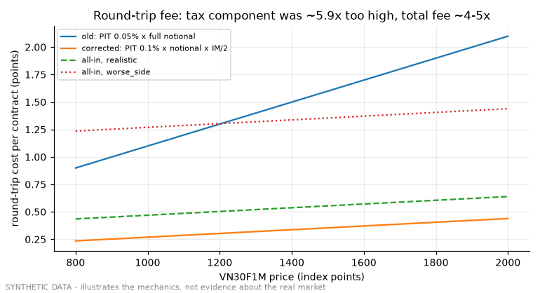

# Demo 01 - cost model and the derivatives PIT correction

Code under test: `historical/backtest_engine/costs.py`, `fee_hurdle.py` (unchanged).

## Fee per round trip, 1 contract, intraday (excludes slippage)

| price | old fee (pts) | corrected fee (pts) | total fee ratio | tax component ratio |
|---|---|---|---|---|
| 900.0 | 1.000 | 0.253 | 4.0x | 5.9x |
| 1242.0 | 1.341 | 0.311 | 4.3x | 5.9x |
| 1500.0 | 1.599 | 0.354 | 4.5x | 5.9x |
| 1900.0 | 2.000 | 0.422 | 4.7x | 5.9x |

Formula (corrected): `0.0995 + 0.00017 x price + 0.0255 x extra_days` points.

## Frozen cost scenarios (pre-registered bars)

| scenario | slip per fill | all-in round trip @1900 (pts) | role |
|---|---|---|---|
| statutory | +0.0000 | 0.422 | Fees only (txn + position + PIT) |
| realistic | +0.1000 | 0.623 | Fees + 2 x 0.1pt E1-measured taker slippage |
| worse_side | +0.5000 | 1.422 | Fees + 2 x 0.5pt worse-side half-spread |
| passive_queue_e1 | -0.0555 | 0.311 | MAKER DESIGN SCENARIO — NOT A PROMOTION BAR |

## Multi-day holds pay the position fee per ICT day

| hold (ICT days crossed) | fee @1900 (pts) |
|---|---|
| 0 | 0.422 |
| 1 | 0.448 |
| 5 | 0.550 |
| 10 | 0.677 |

## Sensitivity to the VSDC initial-margin ratio

| VSDC IM ratio | fee @1900 (pts) |
|---|---|
| 13% | 0.346 |
| 17% | 0.422 |
| 24% | 0.555 |

## Break-even slippage is a curve over price, not a scalar

| price | break-even slip per fill for 1.5 pt gross |
|---|---|
| 900.0 | 0.624 |
| 1242.0 | 0.595 |
| 1500.0 | 0.573 |
| 1900.0 | 0.539 |

## Stage-0 fee hurdle on 300 RANDOM entries (synthetic tape)

`{'n_signals': 300, 'median_mfe_pts': 6.3, 'mean_mfe_pts': 8.286, 'median_fee_pts': 0.409, 'median_cost_pts': 0.609, 'frac_clearing_fee': 0.997, 'frac_clearing_cost': 0.99, 'verdict': 'PASS_STAGE0'}`

Random entries clear the corrected fee on most signals: the gate is a necessary filter (an idea that cannot even reach the fee is dead) and never evidence of edge.

