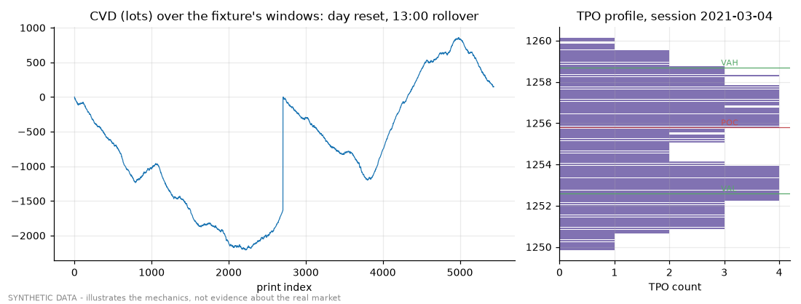

# Demo 02 - order-flow features and cross-stack parity

Fixtures: `historical/tests/fixtures/*synthetic_20210304_20210305*` (SHA-256 pinned in their manifests). Python: `historical/l2/producers`. Rust: `l2_dump` (orderflow-engine).

## Python vs Rust

| feature | rows | python sha256 | rust sha256 | byte-identical |
|---|---|---|---|---|
| tape_cvd_lot_v1 | 5441 | 4c78d2db2d8e | 4c78d2db2d8e | yes |
| tape_cvd_norst_lot_v1 | 5441 | 9d89980fcf2a | 9d89980fcf2a | yes |
| prof_tpo_poc_pts_v1 (observation) | 2 | 980e27f1a786 | 980e27f1a786 | yes |
| prof_tpo_poc_pts_v1 (profile) | 145 | bb9be54ec964 | bb9be54ec964 | yes |

Session 2021-03-04: POC tick 12558, value area 12526–12587 (61 ticks), 19603 prints.

## Book features (Python producer, per minute, first minutes)

| minute (ICT) | ob_spread_pts_v1 | ob_microprice_pts_v1 | ob_depth_resid_imb_ratio_v1 |
|---|---|---|---|
| 2021-03-04 16:00 | 0.2000 | 1249.4588 | -0.1134 |
| 2021-03-04 16:01 | 0.2000 | 1249.1476 | 0.1902 |
| 2021-03-04 18:29 | 0.2000 | 1250.5824 | -0.0021 |
| 2021-03-04 20:00 | 0.2000 | 1249.9071 | -0.2868 |
| 2021-03-04 21:44 | 0.2000 | 1254.2333 | -0.2753 |
| 2021-03-04 21:45 | 0.4000 | 1254.2867 | 0.0150 |

