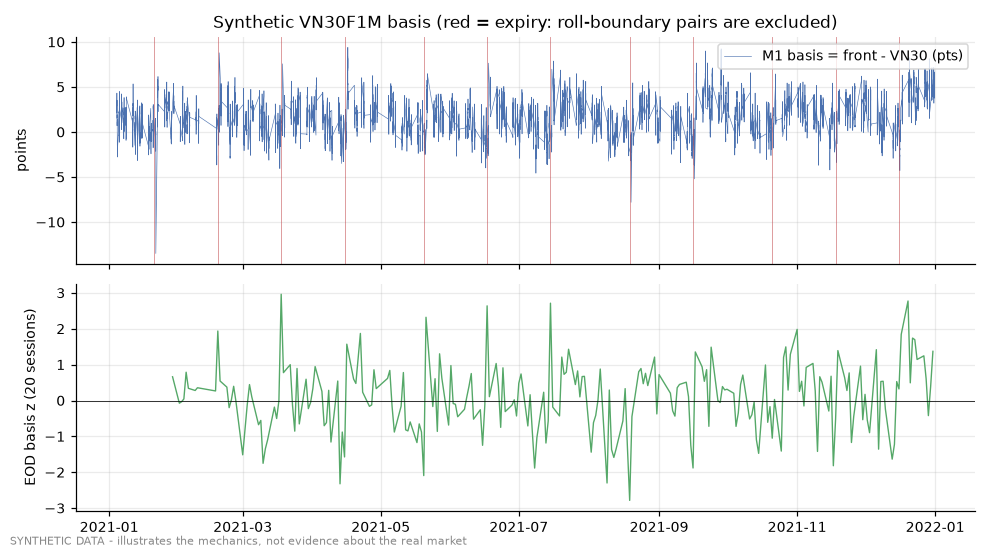
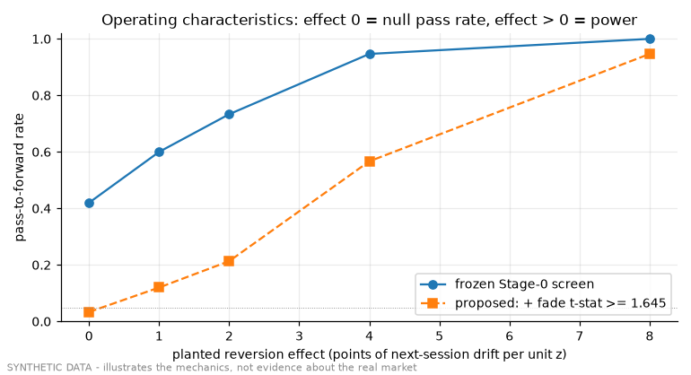

# Demo 03 - basis screen on synthetic markets

Code under test: `historical/research_lab/basis_screen.py` (unchanged). Data: `samples/synthetic`.

## 1. One null market and one market with a planted effect

| market | clean pairs | IC(basis,fwd) | fade n | fade gross/trade | worse-side cost | verdict |
|---|---|---|---|---|---|---|
| null market (no edge) | 219 | 0.0313 | 44 | -4.75 | 1.48 | KILL_AT_SCREEN |
| planted reversion k=8 (power ~100%) | 219 | -0.1925 | 44 | 7.361 | 1.479 | PULSE_REGISTER_FORWARD |

## 2. Holdout lock (`historical/research_lab/holdout_lock.json`)

- frame 2021-01-04..2021-03-05: **accepted** (DEV range)
- frame 2025-01-02..2025-03-05: **refused** - `REFUSED: export [2025-01-02, 2025-03-06) overlaps reserved holdout days [19723, 20516]. Reserved for final ver...`

## 3. Mechanical convergence of the basis

| basis deviation | markets | mean fade gross/trade (pts) | std error |
|---|---|---|---|
| deviation redrawn each morning (true null) | 100 | 0.34 | 0.35 |
| deviation persists overnight (mechanical convergence) | 100 | 2.22 | 0.35 |

## 4. Operating characteristics (150 markets per effect size)

| planted_effect_pts_per_z | frozen_pass_rate | proposed_pass_rate | median_n_fade | median_sd_trade_pts |
|---|---|---|---|---|
| 0.0 | 42% | 3% | 44 | 22.8 |
| 1.0 | 60% | 12% | 44 | 22.9 |
| 2.0 | 73% | 21% | 44 | 22.7 |
| 4.0 | 95% | 57% | 44 | 22.7 |
| 8.0 | 100% | 95% | 44 | 22.9 |

Minimum detectable per-trade gross at 5% / 80% power with n = 44 fade trades and sd = 22.8 pts: **8.5 points**.

Reading:

- With one year of daily data the frozen screen behaves as a direction filter: it passes a large share of pure-noise markets to a forward card. That matches its own design - a PULSE earns a frozen forward test, never an edge claim - and it quantifies why that forward test is needed.
- The proposed t-stat requirement brings the null pass rate to the nominal 5% level, at the price of power for small effects. It would ship as a new pre-registration amendment, not as an edit.
- A basis deviation that persists overnight gives the futures leg a mechanical convergence gain that the fade rule captures. Whether that gain survives costs is exactly the retail-vs-prop question in `docs/knowledge/04-basis-and-index-arbitrage.md`.

