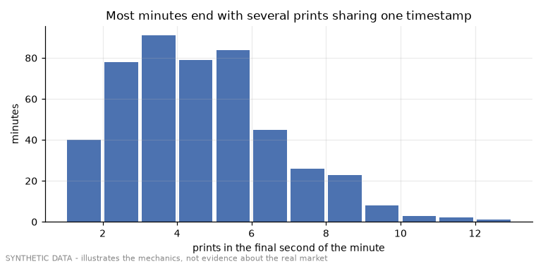

# Demo 04 - same-second prints and the candle close

Synthetic tape: 115,285 continuous-session prints over 480 minutes; 4.1 prints per active second on average; 92% of minutes end with more than one print in the final second.

| method | wrong closes (mean over shuffles) | min / max |
|---|---|---|
| argmax by timestamp (storage order) | 22.9% | 20.4% / 27.7% |
| (timestamp, ingest_seq) | 0.0% | deterministic |

25 storage orders were drawn at random, mimicking merges that reorder rows. The production tape showed 56 % wrong closes (46 % on a clean-feed day); the rate depends on prints per second and on how often same-second prints differ in price.

