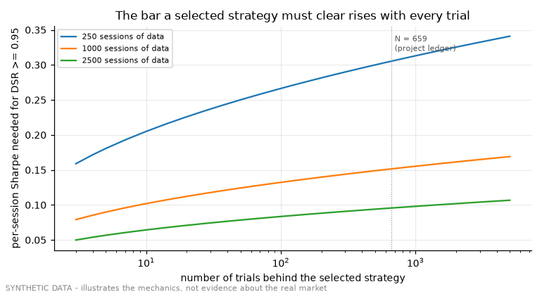

# Demo 05 - validation statistics on noise

Code under test: `historical/optimization/dsr.py` and `overfitting.py` (unchanged). Data: seeded simulated daily returns (`demos/lib/selection_bias.py`), synthetic by construction.

## Best of 200: looks significant, is not

| universe | best annualised Sharpe | best is the skilled one | PSR vs 0 | DSR vs 200 trials | PBO (CSCV, 16 blocks) |
|---|---|---|---|---|---|
| 200 skill-less, 1 year | 2.617 | - | 0.995 | 0.433 | 0.670 |
| 199 skill-less + 1 skilled (true Sharpe 2.5), 1 year | 2.617 | False | 0.995 | 0.447 | 0.675 |
| 199 skill-less + 1 skilled (true Sharpe 2.5), 4 years | 1.973 | True | 1.000 | 0.825 | 0.280 |

Reading, row by row:

1. The best of 200 skill-less strategies earns a PSR against zero close to 1 — it *looks* significant — while its deflated Sharpe, which accounts for the 200 trials that produced it, does not; a PBO at or above 0.5 says the in-sample winner is no better than a coin flip out of sample.
2. With one year of data a genuinely skilled strategy is not even guaranteed to be the one selected: the luckiest noise can out-rank it.
3. With four years of data the skilled strategy is selected, its deflated Sharpe rises and the PBO falls — the statistics separate skill from luck once the sample allows it.

## Minimum backtest length (years) grows with the number of trials

| trials N | years for annual Sharpe 1.0 | years for annual Sharpe 2.0 |
|---|---|---|
| 10 | 2.5 | 0.6 |
| 100 | 6.4 | 1.6 |
| 659 | 9.8 | 2.5 |
| 5000 | 13.6 | 3.4 |

## The bar that retired a gate

With hundreds of trials the per-session Sharpe a candidate needs for DSR >= 0.95 is several times what one year of data can resolve. The research programme measured this on its own ledger (amendment A18: required 0.080 per session against a best-ever 0.027) and stopped using DSR as permission, keeping it as reporting.

