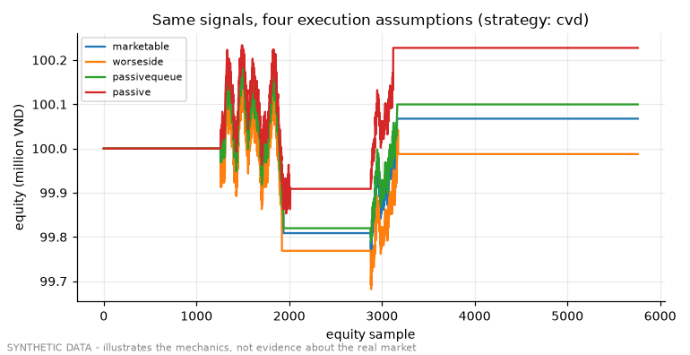

# Demo 06 - Rust backtester and fill models

Input: 115,285 synthetic buyer/seller-initiated prints (two sessions). Engine: `native_platform/crates/backtest-engine` (unchanged).

| strategy | fill model | trades | net P&L (VND) | final equity (VND) |
|---|---|---|---|---|
| cvd | marketable | 4 | 67468 | 100067468 |
| cvd | worseside | 4 | -12532 | 99987468 |
| cvd | passivequeue | 4 | 99667 | 100099667 |
| cvd | passive | 4 | 227472 | 100227472 |
| supertrend | marketable | 3 | 869253 | 100869253 |
| supertrend | worseside | 3 | 749257 | 100749257 |
| supertrend | passivequeue | 3 | 915902 | 100915902 |
| supertrend | passive | 3 | 1049248 | 101049248 |

The ladder brackets execution: `marketable` pays one tick per fill, `worseside` a 0.5-point half-spread, `passivequeue` the E1-calibrated maker expectation, `passive` the optimistic upper bound. On a synthetic tape the P&L itself means nothing; what matters is that the verdict of a design can flip between the bounds — which is why the research protocol freezes the bar it is judged on before the run.

